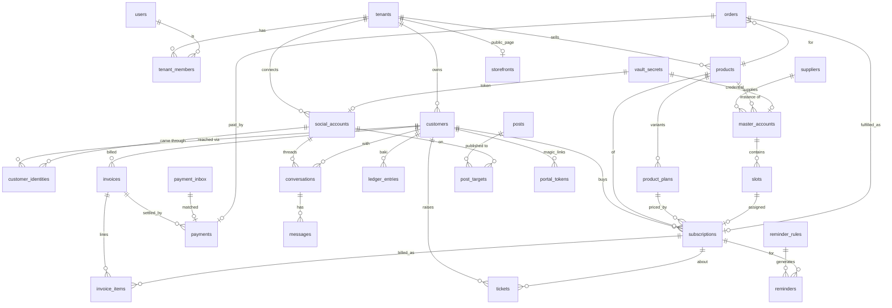

# Database design

PostgreSQL 17. 36 tables, 8 goose migrations in `backend/migrations/`. Every business table has `tenant_id` and an RLS policy (`00008_rls.sql`). Money = `bigint` minor units + `currency`. Text enums are `CHECK` constraints so they can evolve without `ALTER TYPE`.

## Domains

| Migration | Tables | Purpose |
|---|---|---|
| 00001 platform | tenants, users, tenant_members, refresh_tokens, vault_secrets, audit_logs, jobs, notifications | tenancy, auth, encrypted secrets, job queue |
| 00002 customers | customers, customer_identities, customer_notes | CRM; one customer ↔ many channel identities |
| 00003 catalog/inventory | products, product_plans, suppliers, master_accounts, slots | what is sold; upstream accounts and sellable slots |
| 00004 billing | subscriptions, invoices, invoice_items, payments, payment_inbox, ledger_entries | entitlements, invoicing, TrxID verification, baki ledger |
| 00005 social/inbox | social_accounts, conversations, messages, message_templates, posts, post_targets | connected channels, unified inbox, content studio |
| 00006 tickets/reminders | tickets, ticket_comments, reminder_rules, reminders | replacement/complaints; automated reminders |
| 00007 storefront/portal | storefronts, orders, portal_tokens, imports | public shop, orders, magic-link portal, data import |
| 00008 rls | — | row-level security on all tenant tables |

## ERD (core)

## Key rules
- `slots.subscription_id` + `subscriptions.slot_id` are both kept; the service layer assigns/free slots inside one transaction. Partial unique index on free slots makes "next free slot" cheap.
- `payments(tenant_id, method, trx_id)` is unique for non-rejected rows: the same TrxID can never pay twice.
- `customers.due_balance` is a cached sum of `ledger_entries`; the billing service updates both in one transaction.
- `jobs.dedupe_key` prevents duplicate scheduled jobs (e.g. one reminder per rule×subscription×day).
- Credentials and tokens: only `vault_secrets.ciphertext`. `master_accounts.login_hint` is a masked display string.
- RLS: API opens a transaction and runs `SET LOCAL app.tenant_id = $1`. Policies are permissive when the setting is empty so migrations and platform-admin jobs work; the app role must never be superuser.
