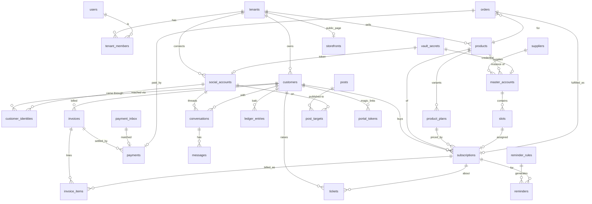

# Database design

PostgreSQL 17. 38 tables, 14 goose migrations in `backend/migrations/`. Every business table has `tenant_id` and a fail-closed, forced RLS policy (`00009_rls_hardening.sql`, ADR-008). Money = `bigint` minor units + `currency`. Text enums are `CHECK` constraints so they can evolve without `ALTER TYPE`.

## Domains

| Migration | Tables | Purpose |
|---|---|---|
| 00001 platform | tenants, users, tenant_members, refresh_tokens, vault_secrets, audit_logs, jobs, notifications | tenancy, auth, encrypted secrets, job queue |
| 00002 customers | customers, customer_identities, customer_notes | CRM; one customer ↔ many channel identities |
| 00003 catalog/inventory | products, product_plans, suppliers, master_accounts, slots | what is sold; upstream accounts and sellable slots |
| 00004 billing | subscriptions, invoices, invoice_items, payments, payment_inbox, ledger_entries | entitlements, invoicing, TrxID verification, baki ledger |
| 00005 social/inbox | social_accounts, conversations, messages, message_templates, posts, post_targets | connected channels, unified inbox, content studio |
| 00006 tickets/reminders | tickets, ticket_comments, reminder_rules, reminders | replacement/complaints; automated reminders |
| 00007 storefront/portal | storefronts, orders, portal_tokens, imports | public shop, orders, magic-link portal, data import |
| 00008 rls | — | row-level security on all tenant tables (superseded by 00009) |
| 00009 rls hardening | — | `psaas_app` role + grants, FORCE RLS, fail-closed policy, key-scoped lookup policies (ADR-008) |
| 00010 payment sms sender | payment_inbox.sender | SMS sender id; `needs_review` status (H4) |
| 00011 social external unique | — | one live connection per (platform, external_id) across tenants (H5) |
| 00012 member invites | tenant_members.invite_token_hash / invite_expires_at / invite_name | one-time invite links (BUG-02/03) |
| 00013 tenant counters | tenant_counters | per-tenant invoice/ticket/order numbers (BUG-11) |
| 00014 oauth states | oauth_states | single-use Meta OAuth state bound to user + tenant (M2) |

## ERD (core)

## Key rules
- `slots.subscription_id` + `subscriptions.slot_id` are both kept; the service layer assigns/free slots inside one transaction. Partial unique index on free slots makes "next free slot" cheap.
- `payments(tenant_id, method, trx_id)` is unique for non-rejected rows: the same TrxID can never pay twice.
- `customers.due_balance` is a cached sum of `ledger_entries`; the billing service updates both in one transaction.
- `jobs.dedupe_key` prevents duplicate scheduled jobs (e.g. one reminder per rule×subscription×day).
- Credentials and tokens: only `vault_secrets.ciphertext`. `master_accounts.login_hint` is a masked display string.
- RLS (ADR-008): the API/worker connect as `psaas_app` (no superuser, no BYPASSRLS, owns nothing); migrations run as the owner (`MIGRATE_DATABASE_URL`). `db.WithTenantTx` runs `set_config('app.tenant_id', $1, true)`; without it every tenant table returns **no rows** (fail-closed, FORCE RLS). Platform tables without RLS: `tenants`, `users`, `refresh_tokens`, `jobs`. Pre-tenant lookups (`db.WithLookup`) use key-scoped policies: `app.lookup_user_id`, `app.lookup_social_id`, `app.lookup_social_key`, `app.lookup_slug`, `app.lookup_token_hash`, `app.lookup_invite_hash`.
- Roles: dev Homebrew `make db-setup` (runs `backend/scripts/dev-db-role.sql`: `psaas_app` LOGIN password `psaas_app` + grants); docker mounts the same script as an init script. Production: create a LOGIN role with a real password and `GRANT psaas_app TO it`; the migration owner needs BYPASSRLS (or superuser) for data migrations on tenant tables.
- Numbers: `db.NextNumber(tx, tenant, kind)` = `INSERT INTO tenant_counters .. ON CONFLICT DO UPDATE SET value = value + 1 RETURNING value` (row lock until commit: contiguous, gap-free on rollback). The global `*_number_seq` sequences are unused (kept for down migrations).
